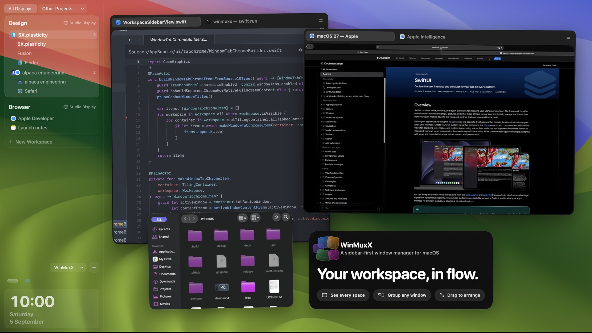
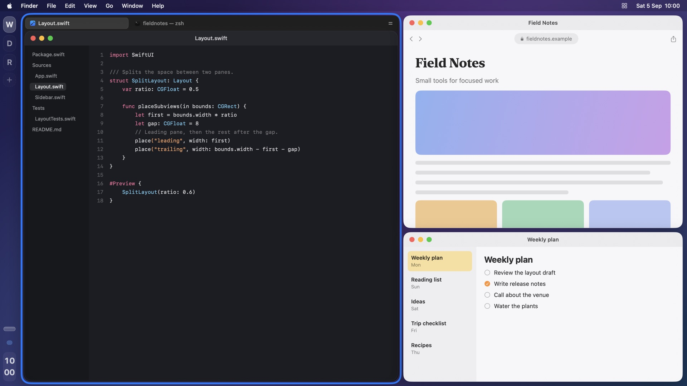

<p align="center">
  
</p>

<h1 align="center">WinMuxX</h1>

<p align="center">A sidebar window manager for macOS, with Dwindle tiling and room to work on ultrawide displays.</p>

<p align="center">
  <a href="https://github.com/gfavaro/WinMuxX/releases">Download</a> ·
  <a href="docs/QUICK_START.md">Quick start</a> ·
  <a href="docs/README.md">Documentation</a> ·
  <a href="docs/FORK.md">Fork guide</a> ·
  <a href="HACKING.md">Development</a>
</p>

<p align="center">
  
  
</p>

WinMuxX tiles your windows, groups them into projects and workspaces, and keeps
them one glance away in a sidebar. It is a personal fork by gfavaro, based on
[ZimengXiong/WinMux](https://github.com/ZimengXiong/WinMux). It is not a
compositor: it moves ordinary windows through the Accessibility API.

## Highlights

- **Dwindle tiling** by default, with built-in window borders and optional master,
  tabbed and Scrolling layouts. See [layouts](docs/LAYOUTS.md).
- **Ultrawide friendly.** A lone window keeps a width and alignment you choose.
  See [windows](docs/WINDOWS.md#lone-windows-and-fullscreen-width).
- **Sidebar** with projects, workspaces and windows, in Liquid Glass or a solid
  color. See [sidebar](docs/SIDEBAR.md).
- **Persistent workspaces** with the names and order you pick, per project and
  display. See [workspaces](docs/WORKSPACES.md).
- **Tab groups** that share one tile, with a tab bar above them.
- **Window search palette**, tap-only shortcuts and per-side modifiers. See
  [shortcuts](docs/SHORTCUTS.md).
- **Recovery.** Windows return to their saved layout after a restart, and the menu
  can restore original frames after a crash. See [menu bar](docs/MENU_BAR.md).

## Install

1. Download the ZIP from [releases](https://github.com/gfavaro/WinMuxX/releases)
   and move `WinMuxX.app` to `/Applications`.
2. Open it and grant **Accessibility** access when macOS asks. WinMuxX never asks
   for Screen Recording.
3. Optionally link the CLI. The link follows future updates; pick another
   directory in your `PATH` if you don't use Homebrew.

   ```sh
   ln -s /Applications/WinMuxX.app/Contents/MacOS/winmuxx-cli /opt/homebrew/bin/winmuxx
   ```

To build from source, run `make fork-build BUILD_NUMBER=<new-number>` and install
`.release/WinMuxX.app` as described in [HACKING.md](HACKING.md). Fork builds use
the configured local signing identity, are not notarized, and have automatic
upstream updates disabled. The upstream Homebrew cask installs WinMux, not WinMuxX.

## First run

1. Open two ordinary windows. WinMuxX tiles them in the current workspace.
2. Use the sidebar to switch workspaces and projects.
3. Open **Settings** from the WinMuxX menu. Everyday pages are always visible;
   Automation and Configuration sit under Advanced. **Find settings** searches by
   name, TOML key or description.
4. If something misbehaves, open Settings → General → **Setup Check**, or run
   `winmuxx doctor`.

Run `winmuxx --help` for every CLI command, or `winmuxx <command> --help` for one.
Help works without the app running. The [command guide](docs/COMMANDS.md) groups them.

| Settings page | What it controls |
| --- | --- |
| General | Start at login, automatic configuration reload |
| Workspaces | Persistent names and order, project deletion, workspace shortcuts |
| Windows | New-window behavior, layout, ultrawide width, pointer focus, tab strips |
| Sidebar | Visibility, placement, widths, display mode, clock |
| Appearance | Glass or solid style, menu-bar indicator, motion, spacing, borders |
| Shortcuts | Presets and editable window-management shortcuts |
| Automation | Startup and event commands |
| Configuration | Full TOML editor with validation and reference |

Settings writes the same TOML file the app reads and applies changes through
configuration reload. Drafts survive page switches, and a failed save can be
retried. See [configuration](docs/CONFIGURATION.md).

## What is different in this fork

WinMuxX has its own identity, CLI, configuration and recovery state. Releases use
`gf-v` tags in this repository.

- Selecting a workspace already visible on another display focuses it there.
  Sidebar clicks on another display ask before bringing it over.
- Learned application minimum sizes constrain layouts. Borders fall back to AppKit
  when the private renderer is unavailable.
- The menu keeps Retile, Fullscreen and Float / Tile Window at the top, groups
  layout actions under Arrange Windows, and offers recovery after an interrupted
  session.

### Migrating

The fork owns `${XDG_CONFIG_HOME:-~/.config}/winmuxx/winmux.toml`. On first launch
it copies the previous `winmux-gf/winmux.toml`, or an original WinMux config if no
fork config exists, without modifying the source. With neither, AeroSpace import
is offered; otherwise a starter config is generated. `--config-path` selects an
explicit file. See [configuration ownership](docs/FORK.md#app-isolation).

## Known limits

- **Accessibility access is required.** macOS asks on first launch. Without it,
  WinMuxX cannot read or move windows.
- **Not notarized.** Fork builds are signed locally. macOS may show a warning on
  first launch; right-click → Open to bypass it.
- **Not a compositor.** WinMuxX moves ordinary windows through the Accessibility
  API. It cannot draw inside them or composite their contents.
- **Private APIs for borders and swipes.** Window borders use a private
  WindowServer renderer when available, with an AppKit fallback. Three-finger
  workspace swipes use a private dock-swipe gesture receiver. Both can break on
  future macOS versions.
- **No multi-space support.** WinMuxX manages windows on the current macOS
  desktop (Space). It does not create or switch Spaces.

## Guides

| Learn | Configure | Contribute |
| --- | --- | --- |
| [Quick start](docs/QUICK_START.md) | [Configuration](docs/CONFIGURATION.md) | [Principles](docs/PRINCIPLES.md) |
| [Concepts](docs/CONCEPTS.md) | [Windows](docs/WINDOWS.md) | [Contributing](CONTRIBUTING.md) |
| [Layouts](docs/LAYOUTS.md) | [Workspaces](docs/WORKSPACES.md) | [HACKING](HACKING.md) |
| [Recipes](docs/RECIPES.md) | [Sidebar](docs/SIDEBAR.md) | [Testing](docs/TESTING.md) |
| [Commands](docs/COMMANDS.md) | [Shortcuts](docs/SHORTCUTS.md) | [Roadmap](docs/ROADMAP.md) |

The [documentation index](docs/README.md) lists everything else.

## Credits

WinMuxX is based on [ZimengXiong/WinMux](https://github.com/ZimengXiong/WinMux).
Configuration and command support also build on
[AeroSpace](https://github.com/nikitabobko/AeroSpace).
