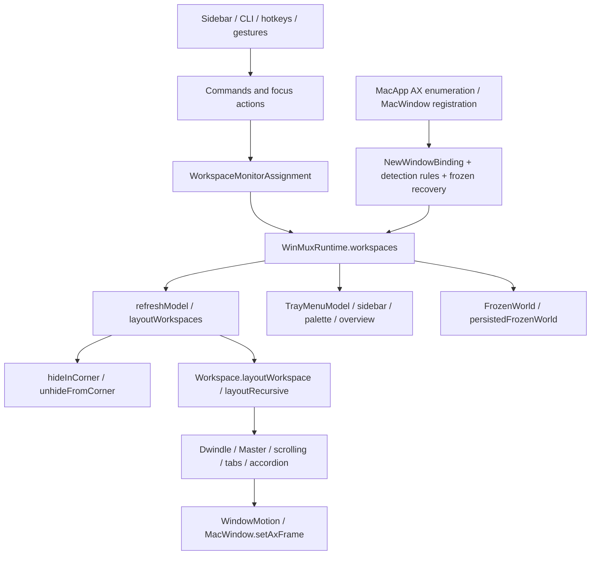

# Native Spaces: technical assessment and Phase 0

Branch: `feat/native-spaces`, based on `e768624b` (the current scrolling and workspace-controls implementation, with the native tray menu restored). The older checkouts and their unrelated changes are untouched.

## Current dependency map

Concrete owners, relative to `Sources/AppBundle`:

| Responsibility | Existing implementation and coupling |
|---|---|
| Identity and lifecycle | `tree/WorkspaceType.swift`: `Workspace.id`, `projectId`, `arrangement`, `reconcileWorkspaceState`; `WinMuxWorkspaceState` indexes identities, names, projects and monitor viewports. Empty virtual workspaces can be created/pruned. macOS-owned Spaces must not use that lifecycle policy. |
| Selection and display ownership | `tree/WorkspaceMonitorAssignment.swift`: `activateWorkspaceForUser`, `setActiveWorkspace`, `rearrangeWorkspacesOnMonitors`, `reconcileSecondaryWorkspaceAssignments`. Hidden virtual slots can be reassigned to the main display; native ownership must instead follow macOS's snapshot. |
| Detection and membership | `MacWindow.getOrRegister` and `NewWindowBinding` choose the focused/startup workspace before rules and recovery. Native membership must be established before inserting a window, and unknown or multi-Space membership cannot be inferred from focus. |
| Visibility and parking | `layout/refresh.swift`: `layoutWorkspaces` parks every inactive workspace and reveals visible ones; `MacWindow.hideInCorner`, `unhideFromCorner`, `HiddenWorkspaceWindowRecovery` enforce virtual hiding. This is the strongest unsafe coupling for a native backend. |
| Layout | `Workspace.layoutWorkspace` and `layoutRecursive` consume existing trees. `DwindleGeometry`, `WorkspaceArrangementGeometry`, tab and accordion branches can remain shared. Inactive native Spaces must not receive frame writes. |
| Native state and focus | `refresh`, `normalizeLayoutReason`, `updateFocusCache`, `GlobalObserver`, per-app AX actors. macOS-minimized, hidden, popup and fullscreen containers already differ from virtual parking. New backend policy must preserve that distinction. |
| Input | `Command.runCmdSeq` is a common policy checkpoint; direct sidebar actions and gesture coordinators also reach workspace policy. Guarding only CLI commands is insufficient. Native mode must not run virtual three-finger workspace switching or override native Mission Control. |
| UI | `TrayMenuModel`, sidebar snapshots/actions, `SwitcherPalette`, `WorkspaceOverviewController` consume workspace visibility and project/display scopes. Native actions need capabilities and native identities rather than virtual display-relocation semantics. |
| Persistence | `FrozenTreeNode`, `FrozenWorld`, `persistedFrozenWorld`, `WorkspaceRecoveryState` preserve window identities, tree state, ownership and original frames. Native layouts need a separate namespace/file and must never reuse virtual placement recovery. |
| Private API boundary | Existing `Sources/PrivateApi` handles AX/window IDs, native borders and raw touch. Phase 0 adds a separate, read-only dynamic SkyLight boundary; no new hard-linked private symbols or Dock injection. |

Documentation mismatch: `docs/LAYOUTS.md` still describes Master as a root layout and says workspace-layout needs a tiled window. The current `Workspace.arrangement`, `transitionArrangement` and command tests establish workspace-wide modes and empty-workspace selection. The native design follows those tested semantics rather than reintroducing the historical model.

## Reference investigation

Sources were inspected at pinned revisions on 2026-10-26; these are evidence of implementation, not proof of current-host compatibility. No reference code is executed or vendored.

| Reference | Inspected revision / findings |
|---|---|
| [Mosaico](https://github.com/Mauto82/Mosaico) | `434b300`: `Displays/SpaceTracker.swift` reads managed displays and window memberships; `Workspaces/WorkspaceManager.swift` keys trees by native Space and disambiguates shared-display Spaces. `Events/EventPoster.swift` uses synthetic Control-digit and drag transport. Its first-membership/unknown-Space fallbacks are unsuitable for our fail-closed policy. |
| [yabai](https://github.com/asmvik/yabai) | `dd84572`: `space_manager.c`, `display.c`, `window.c`, `misc/extern.h`, `osax/payload.m`. Queries are distinct from the privileged scripting addition. SIP-on activation falls back to private synthetic Dock gestures. Bridged movement resolves a non-exported dispatcher. [7.1.25 changelog](https://github.com/asmvik/yabai/blob/dd84572/CHANGELOG.md) and [issue 2788](https://github.com/asmvik/yabai/issues/2788) record movement working again on 26.4; not a cross-version guarantee. |
| [spacekit](https://github.com/cehbz/spacekit) | `dda0dce`: `internal/skylight/skylight.go` dynamically resolves read APIs. `cmd/spaceswitch/native.go` synthesizes Control-arrow at the HID tap. `spacecreate.m` drives Dock Accessibility. Its research notes are secondary claims and were checked against the actual native source and yabai history. |
| [AeroSpace](https://github.com/nikitabobko/AeroSpace) | `74a1bf17`: `MacWindow.swift` parks windows and associates new windows with its own workspace model. This explains WinMuxX's inherited virtual coupling; it is not evidence of a native backend. |
| [Dinky](https://github.com/mikker/Dinky) | `cd1d3ca` (0.22): `DinkyPrivate/query.m`, `events.m`, `move.m` query native displays/memberships and register private WindowServer notifications. Its movement uses a private non-exported dispatcher. Keep API declarations and MIT attribution if implementation code is adapted; this spike is independently implemented. |
| [WinMux](https://github.com/ZimengXiong/WinMux) | `470eedbf`: project/workspace and parking architecture predates this fork's current arrangement and recovery enhancements. Replacing the current tree with upstream's model would lose behavior. |
| [Shoji](https://shojimac.com/docs/guide/multiple-displays/) | Documents per-display layouts inside macOS Spaces. Closed source; its UI claims establish a behavior reference, not which private APIs it uses or whether whole-workspace relocation is supported. |

## API and security classification

| Class | Approach | Decision |
|---|---|---|
| Public | `NSWorkspace.activeSpaceDidChangeNotification`, screen/session notifications, CGWindow inventory, AX window events/frame writes | Use existing event sources. Public Space-change notifications provide invalidation, not native IDs or membership. [Apple notification documentation](https://developer.apple.com/documentation/appkit/nsworkspace/activespacedidchangenotification). |
| Private, read-only, no intended privilege escalation | `SLS/CGSCopyManagedDisplaySpaces`, `SLS/CGSCopySpacesForWindows`, main connection query | Phase 0 dynamically resolves these, validates every topology, retains all memberships, and records actual SIP-on results. Unsupported symbols/invalid data produce an explicit failure. |
| Private write/control | `SLSManagedDisplaySetCurrentSpace`, move-to-managed-Space and asynchronous bridged operations | Not exposed by Phase 0. Symbol presence alone does not establish entitlement or effect. No empty-Space activation claim. |
| Privileged/injected | yabai Dock scripting addition | Excluded. No SIP changes, root helpers, task injection or security changes. |
| Synthetic input / UI automation | Control-digit/arrow, private Dock gestures, title-bar drag, Dock Mission Control AX | Not an automatic fallback. Depends on shortcuts, focus, transition state and OS behavior; must be evaluated separately and explicitly advertised if ever adopted. |
| Fragile techniques | Non-exported symbol-table parsing, private notification payloads, screen-position guesses, ordinal identity | Excluded from initial implementation. Space ordinals are labels, not persistence identity. |

## Architectural alternatives and recommendation

1. **Replace Workspace with a fully generic asynchronous backend graph:** too large; all geometry and synchronous focus/registry consumers would be rewritten unnecessarily.
2. **Treat native Spaces as virtual slots and merely stop parking:** unsafe. Existing creation/pruning, focused-window binding, monitor reassignment and recovery would still mutate macOS-owned membership indirectly.
3. **Retain layout trees; introduce an ownership/reconciliation policy boundary:** preferred. A native snapshot maps macOS identities to layout workspaces. It supplies visibility and membership, gates frame writes, and reports unsupported navigation/movement. Virtual paths retain current behavior. Native read failure suspends native management instead of falling back to virtual parking.

Initial native policy: ordinary desktop Spaces only; unknown/fullscreen Space types observed but unmanaged; shared/all-Spaces/unknown memberships excluded from tiling. Projects initially remain virtual-only. Cross-Space moves, Space creation/deletion and whole-native-Space display relocation are unsupported capabilities, not approximated operations.

An experimental read-only mode is independently useful and safe if the spike works. Automatic native tiling must wait until the active-Space/membership transition boundary is verified with actual desktop transitions; mocks and a single successful snapshot do not establish that safety.

Backend configuration must default to virtual. Recovery stores must be separated, runtime backend switches must first cancel outstanding owners, and inactive native windows must never be interpreted as lost/closed merely because AX cannot see them. UUID plus display/session identity is preferred over a numeric ordinal; absent or changed identity must suspend restoration rather than guess by index or title.

## Phase 0 implementation and gate

`Sources/NativeSpaces` provides a dynamically loaded read-only bridge, validated immutable snapshots and a serialized reader actor. `winmuxx-native-spaces-probe` prints JSON Lines; its optional bounded watch listens to public Space/display/wake events. It never activates, tiles, moves, hides, captures screenshots, prompts for permissions, or reads window titles.

Run `swift run winmuxx-native-spaces-probe --help`. Use explicit `--window-id` arguments to include minimized/inactive windows that public inventory may omit. Query time is measured. The watch has no idle polling and a newest-only mailbox.

## Executed Phase 0 results

Host: Apple Silicon, macOS 27.2 (26B118), SIP enabled (`csrutil status`). Two physical displays were connected during the probe: S34CG50 and Built-in Retina Display. Earlier validation of other features used one display; that older inventory does not describe this run.

- The unprivileged probe resolved the three read-side symbols and enumerated each display's desktop IDs, UUIDs, types and current Space independently.
- Native window membership remained the original desktop ID while the external display was on a newly created, different desktop. The eligibility classifier excludes that inactive window rather than assigning it to the new desktop.
- User-driven native switching delivered `NSWorkspace.activeSpaceDidChangeNotification`. The corrected AppKit watcher published the new snapshot 64.56 ms after the callback; its full inventory query took 63.79 ms. This is callback-to-publication, not physical-gesture latency.
- The built-in desktop's numeric ID changed from 5021 to 5088 while its UUID remained identical. That observation proves numeric IDs alone are unsuitable for persisted identity; it does not establish UUID stability across reboot.
- Five cold-process reads of eleven explicitly requested IDs took 22.02, 16.54, 19.29, 15.84 and 17.24 ms. Two requested IDs had since closed and returned empty membership. An empty membership is retained as unknown, never interpreted as a closed-window signal.
- A full public inventory sampled 155 normal-level IDs but returned membership for only 21. Normal-level WindowServer inventory includes entries that cannot be confidently managed. App ownership, AX identity and eligibility must be verified before future frame writes.
- The installed virtual manager sampled at 0.0% CPU and about 86–96 MiB RSS during investigation. A one-window probe process had an approximately 11 MiB maximum RSS in a bounded sample. These are contextual measurements, not native-backend CPU/memory regression certification.

Two diagnostic bugs were found and corrected before accepting event evidence: async-main alone did not deliver the expected AppKit notification behavior; the probe now runs a prohibited-activation NSApplication event loop. Buffered stdout also left incomplete JSON available during a watch; output now uses complete direct FileHandle writes. The diagnostic has no windows, menu bar, permission requests or periodic polling. It exits after the requested watch duration.

Automated coverage: 14 focused tests exercise malformed/partial topology, 64-bit IDs, unknown/fullscreen types, missing symbols, membership ambiguity, topology changes during a read, bounded requests and per-display eligibility. Native behavior is established only by the actual observations above, not those fixtures.

Artifacts, intentionally ignored and not published: `.build/native-spaces-*.json`, `.jsonl` and logs. The reference checkouts are under `.build/native-spaces-research` and were not executed.

**Decision:** go for the minimal backend boundary and read-only native integration. Automatic native tiling is a separate gate: inactive/unknown memberships must be excluded at the actual frame-writing boundary, legacy parking/recovery must be bypassed, and live transition behavior must be checked before enabling the backend for use.

Unverified: macOS 15 and 26, native fullscreen transitions, sleep/wake, restart/reboot UUID behavior, display disconnect/reconnect, Stage Manager, rcmd interaction, which physical input produced the user's native switch, and simultaneous Space switching on both displays. No native activation/movement API was called. The installed app, signing identity and personal configuration were not changed.
