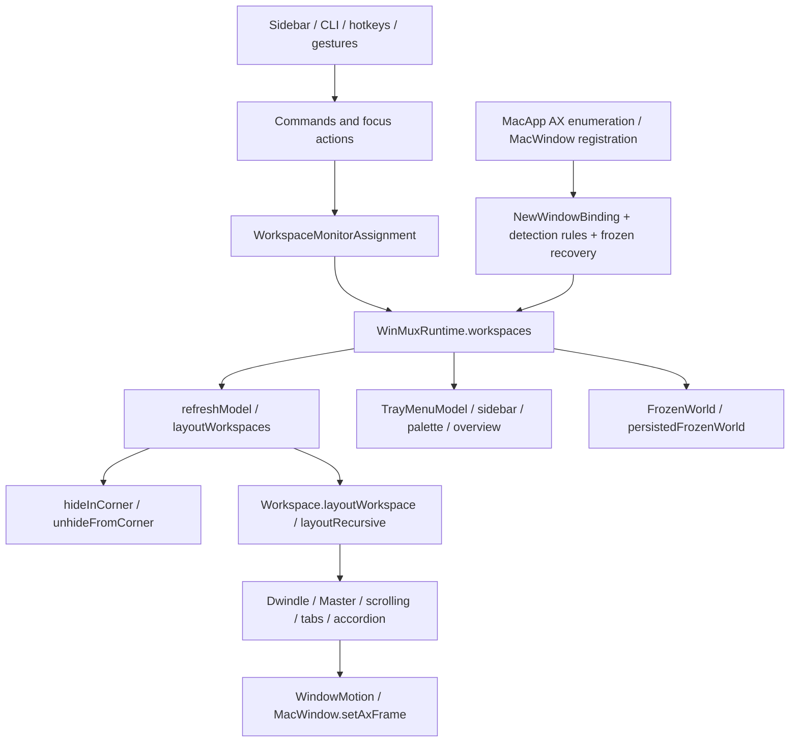

# Native Spaces: technical assessment and Phase 0

Branch: `feat/native-spaces`, based on `e768624b` (the current scrolling and workspace-controls implementation, with the native tray menu restored). The older checkouts and their unrelated changes are untouched.

## Current dependency map

Concrete owners, relative to `Sources/AppBundle`:

| Responsibility | Existing implementation and coupling |
|---|---|
| Identity and lifecycle | `tree/WorkspaceType.swift`: `Workspace.id`, `projectId`, `arrangement`, `reconcileWorkspaceState`; `WinMuxWorkspaceState` indexes identities, names, projects and monitor viewports. Empty virtual workspaces can be created/pruned. macOS-owned Spaces must not use that lifecycle policy. |
| Selection and display ownership | `tree/WorkspaceMonitorAssignment.swift`: `activateWorkspaceForUser`, `setActiveWorkspace`, `rearrangeWorkspacesOnMonitors`, `reconcileSecondaryWorkspaceAssignments`. Hidden virtual slots can be reassigned to the main display; native ownership must instead follow macOS's snapshot. |
| Detection and membership | `MacWindow.getOrRegister` and `NewWindowBinding` choose the focused/startup workspace before rules and recovery. Native membership must be established before inserting a window, and unknown or multi-Space membership cannot be inferred from focus. |
| Visibility and parking | `layout/refresh.swift`: `layoutWorkspaces` parks every inactive workspace and reveals visible ones; `MacWindow.hideInCorner`, `unhideFromCorner`, `HiddenWorkspaceWindowRecovery` enforce virtual hiding. This is the strongest unsafe coupling for a native backend. |
| Layout | `Workspace.layoutWorkspace` and `layoutRecursive` consume existing trees. `DwindleGeometry`, `WorkspaceArrangementGeometry`, tab and accordion branches can remain shared. Inactive native Spaces must not receive frame writes. |
| Native state and focus | `refresh`, `normalizeLayoutReason`, `updateFocusCache`, `GlobalObserver`, per-app AX actors. macOS-minimized, hidden, popup and fullscreen containers already differ from virtual parking. New backend policy must preserve that distinction. |
| Input | `Command.runCmdSeq` is a common policy checkpoint; direct sidebar actions and gesture coordinators also reach workspace policy. Guarding only CLI commands is insufficient. Native mode must not run virtual three-finger workspace switching or override native Mission Control. |
| UI | `TrayMenuModel`, sidebar snapshots/actions, `SwitcherPalette`, `WorkspaceOverviewController` consume workspace visibility and project/display scopes. Native actions need capabilities and native identities rather than virtual display-relocation semantics. |
| Persistence | `FrozenTreeNode`, `FrozenWorld`, `persistedFrozenWorld`, `WorkspaceRecoveryState` preserve window identities, tree state, ownership and original frames. Native layouts need a separate namespace/file and must never reuse virtual placement recovery. |
| Private API boundary | Existing `Sources/PrivateApi` handles AX/window IDs, native borders and raw touch. Phase 0 adds a separate, read-only dynamic SkyLight boundary; no new hard-linked private symbols or Dock injection. |

Documentation mismatch: `docs/LAYOUTS.md` still describes Master as a root layout and says workspace-layout needs a tiled window. The current `Workspace.arrangement`, `transitionArrangement` and command tests establish workspace-wide modes and empty-workspace selection. The native design follows those tested semantics rather than reintroducing the historical model.

## Reference investigation

Sources were inspected at pinned revisions on 2026-10-26; these are evidence of implementation, not proof of current-host compatibility. No reference code is executed or vendored.

| Reference | Inspected revision / findings |
|---|---|
| [Mosaico](https://github.com/Mauto82/Mosaico) | `434b300`: `Displays/SpaceTracker.swift` reads managed displays and window memberships; `Workspaces/WorkspaceManager.swift` keys trees by native Space and disambiguates shared-display Spaces. `Events/EventPoster.swift` uses synthetic Control-digit and drag transport. Its first-membership/unknown-Space fallbacks are unsuitable for our fail-closed policy. |
| [yabai](https://github.com/asmvik/yabai) | `dd84572`: `space_manager.c`, `display.c`, `window.c`, `misc/extern.h`, `osax/payload.m`. Queries are distinct from the privileged scripting addition. SIP-on activation falls back to private synthetic Dock gestures. Bridged movement resolves a non-exported dispatcher. [7.1.25 changelog](https://github.com/asmvik/yabai/blob/dd84572/CHANGELOG.md) and [issue 2788](https://github.com/asmvik/yabai/issues/2788) record movement working again on 26.4; not a cross-version guarantee. |
| [spacekit](https://github.com/cehbz/spacekit) | `dda0dce`: `internal/skylight/skylight.go` dynamically resolves read APIs. `cmd/spaceswitch/native.go` synthesizes Control-arrow at the HID tap. `spacecreate.m` drives Dock Accessibility. Its research notes are secondary claims and were checked against the actual native source and yabai history. |
| [AeroSpace](https://github.com/nikitabobko/AeroSpace) | `74a1bf17`: `MacWindow.swift` parks windows and associates new windows with its own workspace model. This explains WinMuxX's inherited virtual coupling; it is not evidence of a native backend. |
| [Dinky](https://github.com/mikker/Dinky) | `cd1d3ca` (0.22): `DinkyPrivate/query.m`, `events.m`, `move.m` query native displays/memberships and register private WindowServer notifications. Its movement uses a private non-exported dispatcher. Keep API declarations and MIT attribution if implementation code is adapted; this spike is independently implemented. |
| [WinMux](https://github.com/ZimengXiong/WinMux) | `470eedbf`: project/workspace and parking architecture predates this fork's current arrangement and recovery enhancements. Replacing the current tree with upstream's model would lose behavior. |
| [Shoji](https://shojimac.com/docs/guide/multiple-displays/) | Documents per-display layouts inside macOS Spaces. Closed source; its UI claims establish a behavior reference, not which private APIs it uses or whether whole-workspace relocation is supported. |

## API and security classification

| Class | Approach | Decision |
|---|---|---|
| Public | `NSWorkspace.activeSpaceDidChangeNotification`, screen/session notifications, CGWindow inventory, AX window events/frame writes | Use existing event sources. Public Space-change notifications provide invalidation, not native IDs or membership. [Apple notification documentation](https://developer.apple.com/documentation/appkit/nsworkspace/activespacedidchangenotification). |
| Private, read-only, no intended privilege escalation | `SLS/CGSCopyManagedDisplaySpaces`, `SLS/CGSCopySpacesForWindows`, main connection query | Phase 0 dynamically resolves these, validates every topology, retains all memberships, and records actual SIP-on results. Unsupported symbols/invalid data produce an explicit failure. |
| Private write/control | `SLSManagedDisplaySetCurrentSpace`, move-to-managed-Space and asynchronous bridged operations | Not exposed by Phase 0. Symbol presence alone does not establish entitlement or effect. No empty-Space activation claim. |
| Privileged/injected | yabai Dock scripting addition | Excluded. No SIP changes, root helpers, task injection or security changes. |
| Synthetic input / UI automation | Control-digit/arrow, private Dock gestures, title-bar drag, Dock Mission Control AX | Not an automatic fallback. Depends on shortcuts, focus, transition state and OS behavior; must be evaluated separately and explicitly advertised if ever adopted. |
| Fragile techniques | Non-exported symbol-table parsing, private notification payloads, screen-position guesses, ordinal identity | Excluded from initial implementation. Space ordinals are labels, not persistence identity. |

## Architectural alternatives and recommendation

The follow-up [Dinky implementation comparison](NATIVE_SPACES_DINKY_COMPARISON.md)
traces its actual coordinator, event, scheduling and stacking paths and revises the
next native tiling milestone around targeted reconciliation.

1. **Replace Workspace with a fully generic asynchronous backend graph:** too large; all geometry and synchronous focus/registry consumers would be rewritten unnecessarily.
2. **Treat native Spaces as virtual slots and merely stop parking:** unsafe. Existing creation/pruning, focused-window binding, monitor reassignment and recovery would still mutate macOS-owned membership indirectly.
3. **Retain layout trees; introduce an ownership/reconciliation policy boundary:** preferred. A native snapshot maps macOS identities to layout workspaces. It supplies visibility and membership, gates frame writes, and reports unsupported navigation/movement. Virtual paths retain current behavior. Native read failure suspends native management instead of falling back to virtual parking.

Initial native policy: ordinary desktop Spaces only; unknown/fullscreen Space types observed but unmanaged; shared/all-Spaces/unknown memberships excluded from tiling. Projects initially remain virtual-only. Cross-Space moves, Space creation/deletion and whole-native-Space display relocation are unsupported capabilities, not approximated operations.

An experimental read-only mode is independently useful and safe if the spike works. Automatic native tiling must wait until the active-Space/membership transition boundary is verified with actual desktop transitions; mocks and a single successful snapshot do not establish that safety.

Backend configuration must default to virtual. Recovery stores must be separated, runtime backend switches must first cancel outstanding owners, and inactive native windows must never be interpreted as lost/closed merely because AX cannot see them. UUID plus display/session identity is preferred over a numeric ordinal; absent or changed identity must suspend restoration rather than guess by index or title.

## Phase 0 implementation and gate

`Sources/NativeSpaces` provides a dynamically loaded read-only bridge, validated immutable snapshots and a serialized reader actor. `winmuxx-native-spaces-probe` prints JSON Lines; its optional bounded watch listens to public Space/display/wake events. It never activates, tiles, moves, hides, captures screenshots, prompts for permissions, or reads window titles.

Run `swift run winmuxx-native-spaces-probe --help`. Use explicit `--window-id` arguments to include minimized/inactive windows that public inventory may omit. Query time is measured. The watch has no idle polling and a newest-only mailbox.

## Executed Phase 0 results

Host: Apple Silicon, macOS 27.2 (26B118), SIP enabled (`csrutil status`). Two physical displays were connected during the probe: S34CG50 and Built-in Retina Display. Earlier validation of other features used one display; that older inventory does not describe this run.

- The unprivileged probe resolved the three read-side symbols and enumerated each display's desktop IDs, UUIDs, types and current Space independently.
- Native window membership remained the original desktop ID while the external display was on a newly created, different desktop. The eligibility classifier excludes that inactive window rather than assigning it to the new desktop.
- User-driven native switching delivered `NSWorkspace.activeSpaceDidChangeNotification`. The corrected AppKit watcher published the new snapshot 64.56 ms after the callback; its full inventory query took 63.79 ms. This is callback-to-publication, not physical-gesture latency.
- The built-in desktop's numeric ID changed from 5021 to 5088 while its UUID remained identical. That observation proves numeric IDs alone are unsuitable for persisted identity; it does not establish UUID stability across reboot.
- Five cold-process reads of eleven explicitly requested IDs took 22.02, 16.54, 19.29, 15.84 and 17.24 ms. Two requested IDs had since closed and returned empty membership. An empty membership is retained as unknown, never interpreted as a closed-window signal.
- A full public inventory sampled 155 normal-level IDs but returned membership for only 21. Normal-level WindowServer inventory includes entries that cannot be confidently managed. App ownership, AX identity and eligibility must be verified before future frame writes.
- The installed virtual manager sampled at 0.0% CPU and about 86–96 MiB RSS during investigation. A one-window probe process had an approximately 11 MiB maximum RSS in a bounded sample. These are contextual measurements, not native-backend CPU/memory regression certification.

Two diagnostic bugs were found and corrected before accepting event evidence: async-main alone did not deliver the expected AppKit notification behavior; the probe now runs a prohibited-activation NSApplication event loop. Buffered stdout also left incomplete JSON available during a watch; output now uses complete direct FileHandle writes. The diagnostic has no windows, menu bar, permission requests or periodic polling. It exits after the requested watch duration.

Automated coverage: 14 focused tests exercise malformed/partial topology, 64-bit IDs, unknown/fullscreen types, missing symbols, membership ambiguity, topology changes during a read, bounded requests and per-display eligibility. Native behavior is established only by the actual observations above, not those fixtures.

Artifacts, intentionally ignored and not published: `.build/native-spaces-*.json`, `.jsonl` and logs. The reference checkouts are under `.build/native-spaces-research` and were not executed.

**Decision:** go for the minimal backend boundary and read-only native integration. Automatic native tiling is a separate gate: inactive/unknown memberships must be excluded at the actual frame-writing boundary, legacy parking/recovery must be bypassed, and live transition behavior must be checked before enabling the backend for use.

Unverified: macOS 15 and 26, native fullscreen transitions, sleep/wake, restart/reboot UUID behavior, display disconnect/reconnect, Stage Manager, rcmd interaction, which physical input produced the user's native switch, and simultaneous Space switching on both displays. No native activation/movement API was called. The installed app, signing identity and personal configuration were not changed.

## Phase 1: ownership boundary

- **Findings:** `refreshModel`, `layoutWorkspaces` and frozen-world persistence are the narrowest initial virtual ownership gates. Native records must remain separate from Workspace tree mutation until membership-aware registration exists.
- **Changes:** `WinMuxRuntime.workspaceBackend` owns selection and capabilities; virtual lifecycle, parking and recovery are capability-gated. `NativeWorkspaceInventory` separates current versus retained observations, uses owner-scoped generations and exposes UUID-based namespaced recovery keys. `NativeSpacesObservation` serializes notifications with one pending read. The [decision record](NATIVE_SPACES_ADR.md) explains the alternatives.
- **Validation:** 22 NativeSpaces tests and three backend runtime tests passed. `make check` passed with 1,417 AppBundle and 22 NativeSpaces tests, schema and script checks. These are model/regression results, not native frame-write validation.
- **Limitations/risks:** no native tree membership or native frame-writing path is enabled. Existing geometry remains unchanged; capability presence is not private-API write authority.
- **Next milestone:** explicit read-only native boot and diagnostics.

## Phase 2: experimental read-only app integration

- **Findings:** native boot must branch before virtual startup restoration and GlobalObserver initialization. Otherwise old gesture routing, focus binding and hidden-window repair would still run even with parking disabled.
- **Changes:** `[workspace-backend] type = 'native'` opts into observation only; omission keeps virtual mode. Startup takes the read-only branch before permission prompts, virtual observers/hooks and recovery. The native menu and `doctor` show observations; unsupported CLI operations and subscriptions fail explicitly. Backend changes on reload require restart; dry-run remains available. Native mode never enables a private activation or movement fallback. Invalid startup configuration now keeps fallback defaults physically read-only until restart, preventing unintended virtual parking.
- **Validation:** `swift build`, focused suites (22 NativeSpaces plus eight backend/config tests), and `make check` passed. The full gate executed 1,422 AppBundle plus 22 NativeSpaces tests, 16 schema fixtures covering 51 static parser keys, and the script checks. A real development process launched with `.build/native-spaces-observe.toml`; `doctor` reported both display identities and active Spaces with a 34.43 ms query. Actual CLI workspace mutation and virtual query returned unsupported errors. Changing the temporary config to virtual caused reload rejection; restoring native allowed reload. The process sampled at 0.0% CPU, 82,960 KiB RSS after two minutes; this single sample is not performance certification. It then exited cleanly on SIGTERM, leaving the installed virtual manager running.
- **Limitations:** native menu appearance was not inspected through the UI tool; the unbundled development process was not in its app inventory. Native app-event observation is not complete AX window-lifecycle tracking. No native tiling, independent native tree recovery, sidebar/palette/overview integration, navigation or project mapping is claimed.
- **Risks:** read-side private API compatibility remains host-specific. Missing notifications or a rejected transitional read can leave observation unavailable until the next event/manual refresh. Stale observations are labelled and cannot grant native management authority.
- **Next milestone:** native membership reconciliation and guarded native frame operations, followed by an exclusive development-manager validation session. Automatic native tiling remains disabled until that boundary is implemented and verified.

## Phase 3 preparation: retained native layout identity

`NativeSpaceLayouts` now associates observed ordinary desktop UUIDs with existing
Workspace objects and exact display UUIDs. It retains roots across numeric-ID
changes and removal, and rejects unknown display/Space identity without a guessed
fallback. The backend observer binds callbacks to their owning runtime. Switching
one display publishes only changed viewport assignments, retaining other displays'
history. A pending read revokes native membership authority while retaining the last
observed presentation; failed/stopped observation clears active assignments. This
does not register/manage AX windows or enable native tiling.

Five focused model tests cover independent layout state, live nested tab/floating
tree retention, numeric-ID changes, removed Spaces, invalidation, fullscreen and
missing identity, plus unaffected second/third-display history. An additional config
test verifies that a startup hook cannot change backends after selection locks but
before runtime readiness. The development process reported existing Accessibility
permission available without requesting or changing it. Both temporary development
processes were stopped; the installed manager remained running.

The [Dinky source comparison](NATIVE_SPACES_DINKY_COMPARISON.md) now defines the next
runtime work: targeted incoming-Space reconciliation, incremental window lifecycle,
missed-event recovery and frame-job membership authority, then native group stacking.
These remain necessary before claiming a native tiling MVP.

Validation of this preparation: focused native-layout/config suites executed 11
tests successfully. The final `make check` executed 1,428 AppBundle plus 22
NativeSpaces tests (1,450 total), the 16 shared schema fixtures and script checks,
all passing. No native frame writes or physical three-display test was performed.

## Phase 3 progress: targeted discovery and native write authority

**Findings:** Dinky's targeted reconciliation is directly useful here. A Space-only
switch should query incoming Spaces; a coalesced window/app event must retain its
broader current-Space scope, including when its original read was superseded.
WindowServer departure (1326) is not closure (804). Native callbacks also need to
bypass virtual mouse/focus/closed-window recovery paths before AX discovery starts.

**Changes:** `NativeSpacesReader` now supports optional Space-scoped candidate
queries and topology-only reads. `NativeSpacesObservation` adds one native lifecycle
event hub, bounded/coalesced reads, managed-window notification subscriptions and a
500 ms topology audit that never enumerates windows when topology is unchanged.
Audit failure retries are bounded. AX classification populates the existing live
Workspace trees through `NativeWindowReconciler`; stale registration leases cannot
attach nodes after a newer observation. AX work runs concurrently by app with the
existing one-second messaging timeout and a cooperative 1.5-second app read budget.
Unsupported or inaccessible candidates remain unclassified, never inferred closed.
Explicit native closure and confirmed process termination remove nodes; absence
from AX or a failed bounds read does not. Virtual closed-window recovery is gated.

`NativeSpaceWriteAuthority` issues revocable per-job permits, checking live topology,
membership, UUID, PID/launch identity, app visibility and on-screen state. Existing
standard and animated AX paths recheck before individual writes and retries.
Native corner parking is disabled. Observation never installs runtime write permits;
its separate local preflight performs reads only. Already-dispatched AX calls are
not recallable, so the guard is not an atomic WindowServer/AX transaction.

**Validation:** final `make check` passed 1,433 AppBundle and 38 NativeSpaces tests
(1,471 total), 16 shared schema fixtures covering 51 parser keys, and script checks.
Focused coverage includes missed-event recovery, bounded audit retry, malformed
event payloads, incoming-Space targets, coalesced cross-display work, stale AX
registration, PID/launch mismatches, revocation during live validation, revocation
between size/position/reassertion and virtual recovery isolation.

Actual read-only development processes ran on the same SIP-enabled macOS 27.2
host, without installation. A paired sample with one reported display took 25.87 ms
for 128 public-inventory candidates versus 2.78 ms for a Space-scoped read;
topology-only audits sampled about 0.3–0.6 ms. These are samples, not a benchmark
distribution. AX classification retained 11 windows; a local live-ownership
preflight passed 10 eligible identities, while runtime frame writes stayed disabled.
Cold AX/preflight reconciliation sampled 46–96 ms. Native window event registration,
managed-window watch requests and delivery were available. A later snapshot showed
the built-in display present again, with numeric Space ID 5137 and its prior UUID;
this establishes read-side observation, not completed display hot-plug validation.
All temporary development processes were stopped, leaving the installed manager.

**Limitations/risks:** native positioning is still disabled. Frame mutation, delayed
AX responses during an actual Space transition, focus/ordering, sheets/fullscreen,
native layout persistence, sidebar/palette/overview, native command navigation,
rcmd, sleep/wake and OS/hardware combinations remain unverified. The Finder check
opened a temporary window; the user navigated it, so it was left open rather than
closing a window they might be using. No individual-window close validation is
claimed from that check. Private ABI compatibility remains host-specific.

**Next milestone:** explicit native Dwindle/Master/floating opt-in, shared-engine
frame application with native focus/command policy, separate native persistence,
then exclusive development-manager positioning validation. Read-only remains default.

## Phase 3 implementation checkpoint: optional shared-engine tiling

**Findings:** native visibility is a rendering projection, not a membership change.
Filtering children only in layout application was insufficient: navigation geometry
also paired frames with retained child indices, and Dwindle structural conversion
and resize assumed a frame for every retained child. Incoming-Space reads also omit
unchanged displays' memberships. Those omissions must retain presentation without
granting fresh write authority. A concealed preferred master needs its full-tree
index persisted rather than its temporary visible fallback.

**Changes:** `NativeTilingCoordinator` adds a separate, restart-only
`native-spaces.tiling-enabled` opt-in. `NativeLayoutProjection` reuses shared geometry
while preserving concealed leaves, group identity, shares and floating frames.
Structural conversion explicitly measures the complete retained tree. Unsupported
concealed-sibling Dwindle resize returns an error before indexing frames. Native
commands are restricted to implemented workspace-local operations, require fresh
observation, and reject unknown default focus and cross-display movement.

`MacApp` validates live ownership and AX fullscreen/minimized state before writes,
retries and minimum confirmations. Explicit focus has a bounded ownership lease
independent of frame-batch invalidation, with cancellation on newer focus/clicks.
WindowServer events revoke queued frame authority before coalescing. The existing
Mission Control overlay heuristic is shared with the read-side compatibility layer
and checked again at live native operations. Tiling is conservatively suspended
below macOS 27 pending validation of that heuristic on older versions.

`NativeLayoutPersistence` stores versioned UUID-keyed records separately from virtual
recovery and reuses only the frozen-tree codec/restorer. Complete unique matching
within the owning Space is required; incomplete/unsupported trees remain pending,
and unreadable files are never overwritten. Concurrent reconciliations share initial
loading; disk writes reject superseded revisions. The virtual journal is gated off.

**Validation:** `swift build` passed. Focused command/layout regression suites ran
52 tests successfully before the final master-identity addition; subsequent focused
native coverage passed 13 AppBundle tests plus the native authority/transition
tests. Final `make check` passed 1,448 AppBundle plus 40 NativeSpaces tests
(1,488 Swift tests), 19 shared schema fixtures covering 52 parser keys, and all
script/lockfile checks. `git diff --check` passed. These establish automated
regression coverage, not physical native tiling correctness.

A real development process launched with `tiling-enabled = true` **and
`--read-only`** on the same SIP-enabled macOS 27.2 host. Diagnostics reported tiling
suppressed by read-only startup, 10 AX-classified windows, nine successful live
ownership preflights, lifecycle events available, and active desktop 4 on the
external display. One reconciliation sampled 55.39 ms; a topology audit sampled
3.57 ms. These are individual diagnostic samples, not performance certification.
`resize width +20` returned a not-ready/read-only error; `workspace 2` returned
unsupported. No native persistence file was created. The process was stopped;
installed manager PID 70487 remained running. No physical native frame writes,
focus activation or Space mutations were performed.

**Limitations:** this is an implementation checkpoint, not completed native tiling
validation. Tabs/Accordion/scrolling, native navigation, sidebar/palette/overview,
project mapping, launch/detection hooks, empty-desktop default command targeting
and Dwindle resize with concealed siblings remain unavailable. macOS 15/26 tiling,
actual Mission Control transitions, fullscreen/sheets, Stage Manager, delayed AX
responses, real-app restart recovery, display relocation/hotplug/sleep/wake, rcmd
and sustained performance relative to virtual mode remain unverified.

**Risks:** private ABI and the Mission Control signature are host/version-specific.
Per-write live checks add bounded native query work whose interactive cost has not
been measured. An already-dispatched AX call is not recallable. Incomplete native
snapshots intentionally remain protected instead of guessing or deleting state.

**Next milestone:** exclusive development-manager physical positioning/focus and
Space-transition validation before enabling the feature in personal configuration
or integrating overlap-dependent groups and additional UI. No installation or
personal configuration changes were made.

## Phase 3 native validation checkpoint

**Findings:** physical AX positioning works with SIP enabled on the current host.
Dwindle, resized Master, explicit same-app focus, minimization/restoration and a
native fullscreen round trip were executed. Fifteen inactive-desktop windows kept
identical frames during the first native session. Mission Control's production
overlay signature detected user-assisted opening and clearing in a separate
read-only probe. The [native validation record](NATIVE_SPACES_NATIVE_VALIDATION.md)
lists exact scope, evidence and unperformed checks.

**Changes:** `doctor` now exposes per-window JSON rows for identity, eligibility,
floating state and the last layout target, without treating targets as actual AX
measurements. A disposable AppKit fixture provides repeatable window interactions.
`NativeCommandTargetFence` prevents commands waiting on reconciliation from
following focus or ownership into another Space/display. The execution scope
rechecks ownership before subsequent commands and before focus completion.
Floating-to-tiling rechecks its registration after asynchronous size reads;
native directional focus avoids temporarily rebinding floating windows across AX
awaits. Floating windows remain explicitly focusable by window ID.
Runtime layout validation also rejects unsupported arrangements and nested
overlapping groups before frame application, preserving their live trees rather
than allowing configuration to bypass the native command capability policy.

**Validation:** build and focused tests passed. Final `make check` passed 1,454
AppBundle plus 40 NativeSpaces tests (1,494 Swift tests), 19 schema fixtures covering
52 parser keys, script checks and dependency resolution. Native frame comparisons used settled CG snapshots,
not CLI exit status alone. Test managers and fixtures were stopped, the installed
manager was restored, and native persistence was disabled throughout the sessions.
The Space-switch regression failed when target revocation was temporarily bypassed;
the production guard was restored before the final full gate.

**Limitations/risks:** the current host's basic results do not certify other macOS
versions, multi-display movement, delayed apps, native restart persistence,
cross-app ordering or a complete Mission Control/trackpad integration cycle.
Already-dispatched AX calls remain non-atomic with WindowServer transitions.
The queued-command fence's new cancellation paths have model/regression coverage,
not an interactive queued-command/Space-switch reproduction.

**Next milestone:** backend-aware native UI/queries and focused follow-up validation;
overlapping groups remain behind native ordering validation. No installation,
personal configuration change, push or merge was performed.
