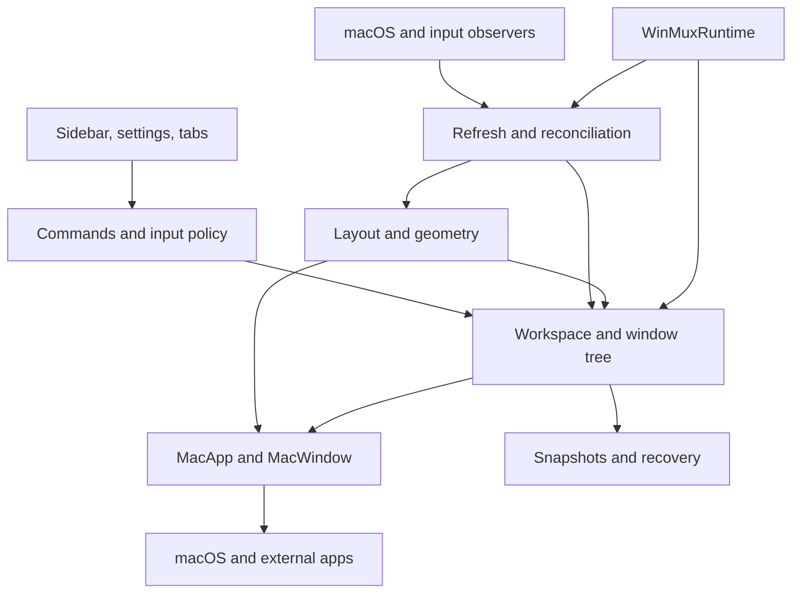

# Components and boundaries

## Plain English overview

Observed: the runtime coordinates the workspace registry, event and refresh processing, layout calculations, macOS adapters, commands and UI. These are code groupings, not independent services. Several commands and layouts directly use workspace internals. The arrows below simplify source dependencies. They do not claim that the build system has separate layers.

## Architectural rules

Existing project rule: MUST reuse workspace assignment policy for sidebar and commands; geometry SHOULD remain testable apart from native effects. Proposed: changes SHOULD reduce cross-arrangement knowledge when a concrete change warrants it; do not introduce a uniform interface merely for symmetry.

## Technical reference

| Subsystem | Responsibilities, state, dependencies and effects | Consumers / coverage |
| --- | --- | --- |
| Runtime | `WinMuxRuntime` composes config, workspace registry, refresh, focus, recovery and display caches; other native registries remain process-scoped. | Most subsystems; [runtime](../../Sources/AppBundle/runtime/WinMuxRuntime.swift), [tests](../../Sources/AppBundleTests/ui/RefreshCoordinatorOwnershipTest.swift) |
| Model | `Workspace`, `TreeNode`, `TilingContainer`, `Window`, `WinMuxWorkspaceState`; membership, display/project selection, arrangement state. Mutated by commands, reconciliation and restoration. | [workspace](../../Sources/AppBundle/tree/WorkspaceType.swift), [registry](../../Sources/AppBundle/tree/WinMuxWorkspaceState.swift), [tests](../../Sources/AppBundleTests/runtime/ModelInvariantCheckerTest.swift) |
| Layout | `layoutRecursive`, geometry helpers and arrangement state calculate frames and trigger native writes; reads model/config/display. | [traversal](../../Sources/AppBundle/layout/layoutRecursive.swift), [geometry test](../../Sources/AppBundleTests/layout/ScrollingGeometryTest.swift) |
| Native observation | `MacApp`, `MacWindow`, `AxSubscription`, `GlobalObserver`; native AX threads, observers, process and window lifetime, frame/focus writes. | [subscription](../../Sources/AppBundle/util/AxSubscription.swift), [observer](../../Sources/AppBundle/GlobalObserver.swift), [native tests](../../Sources/AppBundleTests/model/RefreshFailureRecoveryTest.swift) |
| Refresh | `RefreshCoordinator` coalesces and tracks sessions; `refresh.swift` reconciles state and schedules work. | [coordinator](../../Sources/AppBundle/runtime/RefreshCoordinator.swift), [refresh](../../Sources/AppBundle/layout/refresh.swift) |
| Persistence | Frozen world writer/restart matching and separate original-frame recovery journal; configuration store saves TOML. | [snapshot](../../Sources/AppBundle/tree/frozen/persistedFrozenWorld.swift), [frame recovery](../../Sources/AppBundle/recovery/WindowRecoveryController.swift), [restart test](../../Sources/AppBundleTests/tree/RestartWorkspaceTest.swift) |
| Input/UI | Commands, hotkeys, mouse/gesture coordinator and AppKit/SwiftUI surfaces route actions into model; some are arrangement-aware. | [commands](../../Sources/AppBundle/command/impl/FocusCommand.swift), [gestures](../../Sources/AppBundle/mouse/WorkspaceGestureCoordinator.swift) |

Observed: direct references run both between model and layout helpers, and commands branch on arrangement; this is coupling, not proof of a module import cycle. Runtime has broad composition responsibilities, but it is not the only process-wide owner. UI/drag and persistence logic span multiple files; quantify actual changes before calling them defects. Private APIs include `_AXUIElementGetWindow` and dynamically resolved WindowServer border symbols ([header](../../Sources/PrivateApi/include/private.h), [bridge](../../Sources/PrivateApi/border.m)); OS behavior and fallback are version-sensitive. Public AX/AppKit/CoreGraphics calls can fail or be delayed. See [reliability](../RELIABILITY.md).

On macOS 27, an opaque full-height sidebar owns a separate click-through surface with fixed inward curves above normal application-window shadows. It follows the sidebar's lifetime and color; transparent and centered sidebars do not use it. The curves do not track windows and can be visible even when no window is adjacent.

## Failure modes

An outdated observer or delayed task can change a later interaction. Generation checks, cancellation and cleanup exist on specific paths, but not universally. Failed AX registration and unresponsive apps have bounded retry/budget policy. Tests cited above do not establish OS support.

## Open questions

Unknown: a complete static dependency-cycle inventory and the proportion of native operations covered by fallback. Proposed target boundaries require a separately approved decision if dependency direction changes materially.
