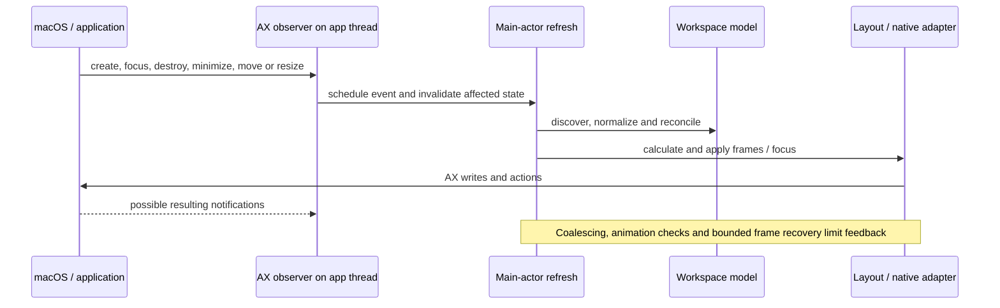
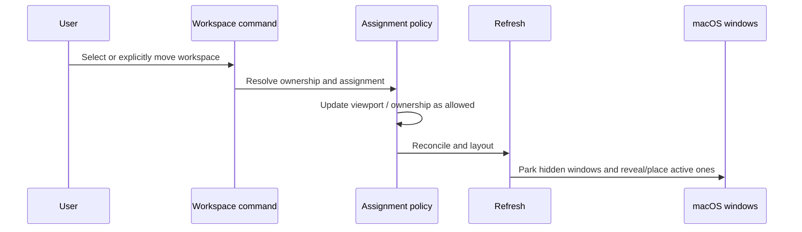

# Events and reconciliation

## Plain English overview

Observed: events signal that WinMuxX should reconcile its model with a desktop that can change independently. A window movement initiated by WinMuxX may itself generate a macOS notification. The code combines some refresh requests. It also limits repeated attempts to move a window back when an application moves it. This is not a universal exactly-once event system.

## Architectural rules

Existing: delayed destruction notifications check emitting application ownership before retiring a reused window ID. Proposed: event handlers SHOULD treat notifications as hints, revalidate state before mutation, and prevent stale work from overwriting newer user actions. A change to major event processing requires the governance review.

## Technical reference

| Origin and entry | Processing, mutation and side effects | Reconciliation / error and ordering evidence |
| --- | --- | --- |
| AX create/focus/destroy/minimize: `MacApp` / `AxWindow` subscriptions and `refreshObs` | AX callback resolves IDs, dispatches to main actor; destruction can retire matching managed window, minimize invalidates cached native state; refresh discovers and normalizes. | Ownership check protects reused ID; fallback invalidates app cache when ID unavailable. [refresh](../../Sources/AppBundle/layout/refresh.swift), [subscriptions](../../Sources/AppBundle/util/AxSubscription.swift). |
| AX move/resize: `movedObs`, `resizedObs` | Mouse policy distinguishes manipulation and schedules refresh; frame recovery waits for settling and may reapply a tile. | Some redundant geometry events are dropped while another geometry/reset refresh runs; `FrameRecovery` cancels pending checks, skips animation and caps attempts per tile. [mouse](../../Sources/AppBundle/mouse/mouse.swift), [recovery](../../Sources/AppBundle/runtime/FrameRecovery.swift). Not every feedback path is known to be suppressed. |
| App activation/termination/wake: `GlobalObserver` | Activation records/schedules refresh; termination cancels retries/detection and records closed windows before normal refresh. Wake triggers observer refresh. | Selection generation stops an older activation from overriding a newer explicit selection. [observer](../../Sources/AppBundle/GlobalObserver.swift), [refresh](../../Sources/AppBundle/layout/refresh.swift). |
| Display change: `NSApplication.didChangeScreenParametersNotification` | Display cache and display policy refresh; reconcile display viewports/assignments and layout with new usable rect. | Settled follow-up and UUID/point matching matter; a disconnected UUID need not resolve. [monitor](../../Sources/AppBundle/model/Monitor.swift), [observer](../../Sources/AppBundle/ui/core/MonitorConfigurationObserver.swift). |
| Workspace or layout command / shortcut | Command changes model via assignment or arrangement transition, then session refresh applies geometry/focus. | Explicit moves and selection have different policies. [assignment](../../Sources/AppBundle/tree/WorkspaceMonitorAssignment.swift), [transition](../../Sources/AppBundle/tree/MasterLayout.swift). |
| Trackpad: Dock gesture event tap | `WorkspaceGestureCoordinator` routes vertical workspace swipe or horizontal Scrolling swipe; moving the strip changes its offset and release updates focus. Other gestures can be returned to macOS. | The tracker can cancel a claimed gesture. The horizontal receiver checks workspace visibility and arrangement on updates and committed ends. It does not compare session ID or epoch. Frame writes use the session ID, and deferred minimap work checks the epoch. Event tap availability and physical delivery remain native-dependent. [coordinator](../../Sources/AppBundle/mouse/WorkspaceGestureCoordinator.swift), [Dock](../../Sources/AppBundle/mouse/DockWorkspaceSwipe.swift), [scrolling](../../Sources/AppBundle/mouse/ScrollingDockSwipe.swift). |
| Startup/restoration: discovery | Snapshot loaded, then discovered `MacWindow` attempts saved matching and tree reconstruction; unmatched entries remain pending within bounded recovery rules. | Retry and missing native state are not proof of absence; [snapshot](../../Sources/AppBundle/tree/frozen/persistedFrozenWorld.swift), [registration](../../Sources/AppBundle/tree/MacWindow.swift). |

AX registration retries and per-refresh `cannotComplete` budgets are described in [reliability](../RELIABILITY.md). `RefreshCoordinator` tracks active and pending work and generations, and decides whether an event is dropped, coalesced or starts a session ([source](../../Sources/AppBundle/runtime/RefreshCoordinator.swift), [policy tests](../../Sources/AppBundleTests/runtime/RefreshCoordinatorPolicyTest.swift)). This is a summary. The diagram does not guarantee event order, native response, or coverage of every failure branch.

### Horizontal Scrolling gesture lifetime

`DockWorkspaceSwipeSource` owns the horizontal `DockSwipeTracker` and `DockScrollingSwipeReceiver`. The tracker claims, completes, or abandons a gesture. Abandonment sends a cancelled end to a claimed receiver. Reconfiguration stops the source and abandons its trackers. The coordinator resets the separate vertical workspace swipe controller when configuration changes. See [Dock source](../../Sources/AppBundle/mouse/DockWorkspaceSwipe.swift) and [coordinator](../../Sources/AppBundle/mouse/WorkspaceGestureCoordinator.swift).

At start, the horizontal receiver stores a weak workspace reference and creates a gesture session ID. Updates require that workspace to be visible and use Scrolling. An update changes its offset and focus hint without changing focus. A committed end selects a column and focuses its most recent window. An end clears the motion flag, session ID and receiver reference. A cancelled end does not select a column. See [receiver](../../Sources/AppBundle/mouse/ScrollingDockSwipe.swift).

An arrangement transition clears motion and session state. Arrangement and preferred display changes increment `sessionEpoch`. The minimap checks that epoch for deferred work. The horizontal receiver does not capture or compare the epoch or session ID on its callbacks. It retains the workspace reference until end. A workspace switch makes updates ineligible while the workspace is hidden. A move or a switch away and back can leave the original workspace visible and eligible again. Observed in tests: after a display-ownership change the receiver still accepts callbacks for its workspace; an arrangement change makes them ineligible until Scrolling returns ([receiver lifecycle tests](../../Sources/AppBundleTests/ui/ScrollingReceiverLifecycleTest.swift), [tracker lifecycle tests](../../Sources/AppBundleTests/ui/ScrollingGestureLifecycleTest.swift)). Physical delivery of such late callbacks is still not established. Gesture frame writes use the session ID, which is a separate safeguard. See [workspace state](../../Sources/AppBundle/tree/WorkspaceType.swift), [transition](../../Sources/AppBundle/tree/MasterLayout.swift), [minimap](../../Sources/AppBundle/ui/WorkspaceScrollingMinimap.swift), and [native frame write](../../Sources/AppBundle/tree/MacWindow.swift).

## Failure modes

Out-of-order AX events, process ID reuse, an unresponsive app, event tap loss and display churn may leave model and desktop temporarily divergent. Existing focused tests include [refresh failure recovery](../../Sources/AppBundleTests/model/RefreshFailureRecoveryTest.swift), [frame budget](../../Sources/AppBundleTests/runtime/FrameRecoveryBudgetTest.swift) and [focus sync](../../Sources/AppBundleTests/RefreshFocusSyncTest.swift); physical delivery is not certified.

## Open questions

Unknown: complete event-storm bounds across all observers and ordering guarantees supplied by macOS. No global deduplication or exactly-once guarantee was established. Each sequence diagram describes intent and identified entry points. It does not show every call stack.
