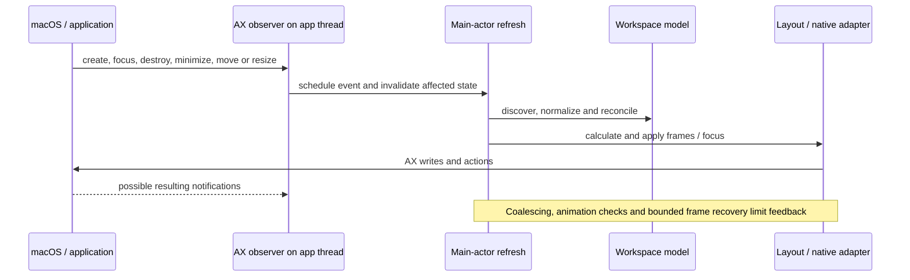
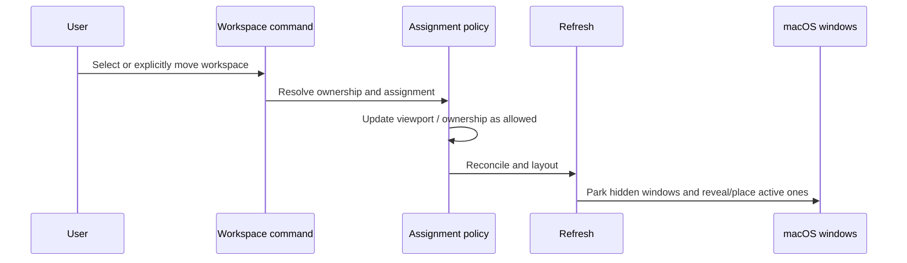

# Events and reconciliation

## Plain English overview

Observed: events are signals to reconcile a model with a desktop that can change independently. A window movement initiated by WinMuxX may itself generate a macOS notification. The code coalesces some refresh work and limits repeated attempts to fight applications; this is not a universal exactly-once event system.

## Architectural rules

Existing: delayed destruction notifications check emitting application ownership before retiring a reused window ID. Proposed: event handlers SHOULD treat notifications as hints, revalidate state before mutation, and prevent stale work from overwriting newer user actions. A change to major event processing requires the governance review.

## Technical reference

| Origin and entry | Processing, mutation and side effects | Reconciliation / error and ordering evidence |
| --- | --- | --- |
| AX create/focus/destroy/minimize: `MacApp` / `AxWindow` subscriptions and `refreshObs` | AX callback resolves IDs, dispatches to main actor; destruction can retire matching managed window, minimize invalidates cached native state; refresh discovers and normalizes. | Ownership check protects reused ID; fallback invalidates app cache when ID unavailable. [refresh](../../Sources/AppBundle/layout/refresh.swift), [subscriptions](../../Sources/AppBundle/util/AxSubscription.swift). |
| AX move/resize: `movedObs`, `resizedObs` | Mouse policy distinguishes manipulation and schedules refresh; frame recovery waits for settling and may reapply a tile. | Some redundant geometry events are dropped while another geometry/reset refresh runs; `FrameRecovery` cancels pending checks, skips animation and caps attempts per tile. [mouse](../../Sources/AppBundle/mouse/mouse.swift), [recovery](../../Sources/AppBundle/runtime/FrameRecovery.swift). No claim that every feedback path is suppressed. |
| App activation/termination/wake: `GlobalObserver` | Activation records/schedules refresh; termination cancels retries/detection and records closed windows before normal refresh. Wake triggers observer refresh. | Selection generation stops an older activation from overriding a newer explicit selection. [observer](../../Sources/AppBundle/GlobalObserver.swift), [refresh](../../Sources/AppBundle/layout/refresh.swift). |
| Display change: `NSApplication.didChangeScreenParametersNotification` | Monitor cache and monitor policy refresh; reconcile viewports/assignments and layout with new usable rect. | Settled follow-up and UUID/point matching matter; a disconnected UUID need not resolve. [monitor](../../Sources/AppBundle/model/Monitor.swift), [observer](../../Sources/AppBundle/ui/core/MonitorConfigurationObserver.swift). |
| Workspace or layout command / shortcut | Command changes model via assignment or arrangement transition, then session refresh applies geometry/focus. | Explicit moves and selection have different policies. [assignment](../../Sources/AppBundle/tree/WorkspaceMonitorAssignment.swift), [transition](../../Sources/AppBundle/tree/MasterLayout.swift). |
| Trackpad: Dock gesture event tap | `WorkspaceGestureCoordinator` routes vertical workspace swipe or horizontal Scrolling swipe; strip pan changes offset and release updates focus. Other gestures can be returned to macOS. | Sessions/epochs and cancellation guard selected stale interactions; event tap availability and actual gesture handling remain native-dependent. [coordinator](../../Sources/AppBundle/mouse/WorkspaceGestureCoordinator.swift), [Dock](../../Sources/AppBundle/mouse/DockWorkspaceSwipe.swift), [scrolling](../../Sources/AppBundle/mouse/ScrollingDockSwipe.swift). |
| Startup/restoration: discovery | Snapshot loaded, then discovered `MacWindow` attempts saved matching and tree reconstruction; unmatched entries remain pending within bounded recovery rules. | Retry and missing native state are not proof of absence; [snapshot](../../Sources/AppBundle/tree/frozen/persistedFrozenWorld.swift), [registration](../../Sources/AppBundle/tree/MacWindow.swift). |

AX registration retries and per-refresh `cannotComplete` budgets are described in [reliability](../RELIABILITY.md). `RefreshCoordinator` tracks active/pending work and generations ([source](../../Sources/AppBundle/runtime/RefreshCoordinator.swift)). This is a summary; event order, native response and every failure branch are not guaranteed by the diagram.

## Failure modes

Out-of-order AX events, process ID reuse, an unresponsive app, event tap loss and display churn may leave model and desktop temporarily divergent. Existing focused tests include [refresh failure recovery](../../Sources/AppBundleTests/model/RefreshFailureRecoveryTest.swift), [frame budget](../../Sources/AppBundleTests/runtime/FrameRecoveryBudgetTest.swift) and [focus sync](../../Sources/AppBundleTests/RefreshFocusSyncTest.swift); physical delivery is not certified.

## Open questions

Unknown: complete event-storm bounds across all observers and ordering guarantees supplied by macOS. No global deduplication or exactly-once guarantee was established. A sequence diagram describes intent and identified entry points, not all call stacks.
