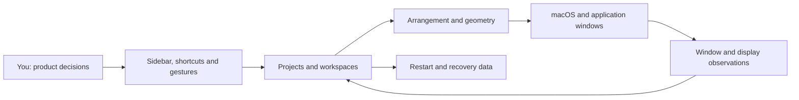

# Product Manager architecture review

## Plain English overview

WinMuxX coordinates your workspaces with windows controlled by macOS and other applications. It creates its own workspaces and groups them into projects. Each display shows one workspace. Other workspaces keep their windows out of view until needed. Selecting a workspace respects the display it belongs to. An explicit move brings the whole workspace, including its organization, to another display.

Inside each workspace a tree records windows and nested groups. The selected arrangement calculates how to display them. Dwindle divides space. Tabbed shows selected windows within groups. Scrolling arranges columns in a strip that you can move with a trackpad. Master emphasizes one group. The app listens for window, application, input and display changes, updates its model and asks apps to move windows. Applications can refuse, respond slowly, or disappear. WinMuxX must reconcile its model with what it observes.

WinMuxX saves workspace organization for restart and separately keeps information for recovering original window positions. When an application reopens, it tries to recognize windows using the evidence available. It intentionally avoids forcing some ambiguous matches. Preferences live in the configuration file. Recovery data is stored separately from preferences. Existing product behavior is described in [principles](../PRINCIPLES.md) and [workspace examples](../WORKSPACE_BEHAVIOR.md).

## Architectural rules

Existing: selection and explicit movement have different meanings, and workspace moves preserve organization. New significant changes to identity, ownership, layouts, event processing or saved-state format require your approval after a plain-English proposal. Routine engineering choices remain with the agent. See [governance](GOVERNANCE.md).

## Technical reference: architecture map

### Important decisions

| Choice | Benefit and trade-off | Working well? / revisit? |
| --- | --- | --- |
| WinMuxX-managed workspaces, with hidden windows parked | Work can travel between displays with its organization; depends on external apps accepting window operations. | Observed implementation and tests support the model; real apps and displays remain variable. Revisit the mechanism only with a concrete product need. |
| Per-workspace arrangement, including Scrolling gestures | Different kinds of work can use different presentations; the modes share a tree and therefore influence one another. | Existing tests cover examples, not every transition. Improve coverage before considering a redesign. |
| Conservative window recognition | Avoids confidently moving the wrong similar window; some windows may not regain their previous position. | The limitation is inherent in incomplete metadata. Revisit only with a clear user experience and evidence. |
| Separate configuration, saved organization and frame recovery | Each store serves a different purpose; they can reflect different moments after an interruption. | Recovery paths exist, but complete crash consistency has not been proven. Test failure cases. |
| Display UUID plus coordinate-based live viewports | Supports reconnecting displays while accommodating geometry changes; missing or ambiguous identifiers complicate recovery. | Model tests exist; physical display sequences need separate validation. |

### Architectural health

Strengths: explicit selection versus movement policy, bounded retries and safeguards against some event feedback, testable geometry, and cautious recovery. Verified limitations: restart matching may reject ambiguity; a Scrolling offset is saved only when that arrangement is active at snapshot time; private macOS interfaces are used. Potential problems, not established defects: missed placement during rare event races, incomplete behavior across every layout transition, and topology-dependent recovery. See [audit](AUDIT.md) for evidence and priorities.

### Proposed improvements

1. **Test switching between all arrangements.** This protects windows and groups when changing presentation. It is the smallest useful step because it checks current behavior before redesigning it. Tests can reveal differences in intended behavior; doing nothing leaves future layout changes harder to assess.
2. **Exercise recovery with ambiguous and late windows, and display changes.** This makes uncertain restoration visible and tests safety. The risk is treating assumptions in fixtures as promises macOS cannot meet. Doing nothing leaves rare restart and display problems harder to diagnose.
3. **Decide how long a Scrolling position should be remembered.** The saved position can be absent if another arrangement is active at restart. A targeted persistence change would be simpler than redesigning layouts, but could restore a stale position or require compatibility handling. Doing nothing keeps today's documented behavior.

### Decisions requiring Product Manager approval

No architecture change is requested for implementation now. If you want a persistence change, the meaningful decision is: **Should a workspace remember its last Scrolling position across a restart even when it was using another arrangement at shutdown?** Recommended: first run the documented reproduction and confirm the experience; if the position is important, preserve it with a compatible proposed design. Alternative: keep current behavior. Trade-offs are more predictable return versus extra saved state and potential stale offsets. An agent should prepare a concrete ADR and compatibility plan before approval; this document does not approve a change.

### Questions for the Product Manager

Is returning to the previous Scrolling position after switching layouts and restarting important enough to preserve as a product behavior? There are no other product decisions needed to start the test coverage work.

## Failure modes

An app can be slow, disappear, or refuse a requested frame. The identity of a saved window can be ambiguous. The result may be a misplaced or unrecovered window even when the internal model is healthy. The audit separates evidence from potential impact; automated tests do not certify physical operation.

## Open questions

Physical gesture feel, third-party Accessibility behavior and display unplug/replug were not tested during this documentation task. The choice above requires actual product preference, not an agent's assumption.
